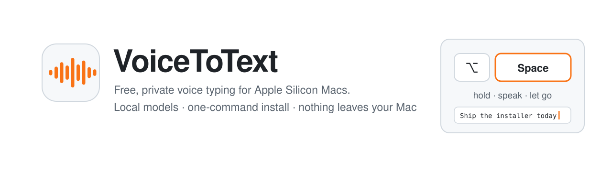
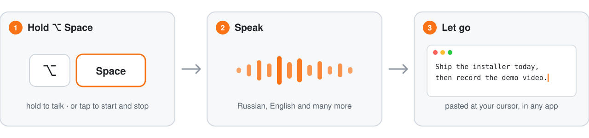
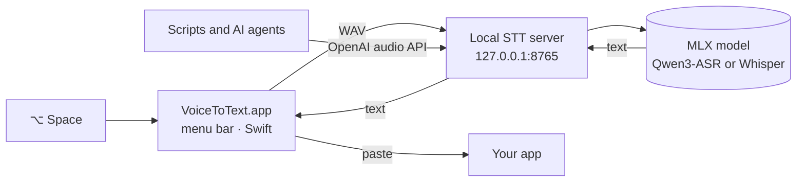

<p align="center">
  <picture>
    <source media="(prefers-color-scheme: dark)" srcset="docs/assets/banner-dark.svg">
    
  </picture>
</p>

<p align="center">
  <a href="https://github.com/FUYOH666/VoiceToText/releases/latest"></a>
  <a href="https://github.com/FUYOH666/VoiceToText/actions/workflows/ci.yml"></a>
  
  
  <a href="LICENSE"></a>
</p>

<p align="center">
  <a href="#install">Install</a> ·
  <a href="#features">Features</a> ·
  <a href="#models">Models</a> ·
  <a href="#for-ai-agents">For AI agents</a> ·
  <a href="#how-it-works">How it works</a> ·
  <a href="#faq">FAQ</a> ·
  <a href="README.ru.md">Русский</a>
</p>

**Hold <kbd>⌥ Option</kbd> + <kbd>Space</kbd>, speak, let go — the text appears where your cursor is.** VoiceToText is a menu bar app for Apple Silicon Macs that turns your voice into text with speech models running on your own machine. No account, no subscription, no cloud.

<p align="center">
  <picture>
    <source media="(prefers-color-scheme: dark)" srcset="docs/assets/how-it-works-dark.svg">
    
  </picture>
</p>

## Why

Most people speak around 150 words a minute and type around 40. When your hands can't keep up with your head, thoughts get lost: you switch context, you shorten the idea, you forget the second half. Speaking keeps you in the flow. You may say more than you need, but you never say less — and extra words are easy to cut.

VoiceToText is built for people who think out loud all day: founders, managers, engineers, anyone who writes a lot of messages, notes and prompts.

## Install

Apple Silicon Mac (M1 or newer), macOS 13 Ventura or later. Paste into Terminal:

```bash
curl -fsSL https://raw.githubusercontent.com/FUYOH666/VoiceToText/main/scripts/install.sh | bash
```

The installer builds the app on your Mac from source, so there is no notarization prompt to fight. It checks your Mac, installs [uv](https://docs.astral.sh/uv/) if needed, puts everything in `~/.voicetotext`, downloads the speech model recommended for your memory and starts the app. macOS then asks once for **Microphone** and **Accessibility** (to paste). Run the same command again to update.

<details>
<summary>Options, uninstall and installing from a clone</summary>

- Options go after `bash -s --`, for example `… | bash -s -- --model whisper-large-v3-turbo-8bit`. `--dry-run` prints the steps, `--no-model` skips the download. The list of models: `cd ~/.voicetotext && uv run python scripts/prefetch_model.py --list`.
- Uninstall: `bash ~/.voicetotext/scripts/uninstall.sh` (add `--purge` to delete history and settings too).
- From a clone (developers):

  ```bash
  git clone https://github.com/FUYOH666/VoiceToText.git && cd VoiceToText
  uv sync --extra qwen
  macos/scripts/build.sh
  uv run python src/vtt2/main.py --install
  ```

</details>

## Features

- **Push-to-talk or tap.** Hold <kbd>⌥ Space</kbd> while you speak and let go, or tap once to start and once to stop. <kbd>Esc</kbd> cancels.
- **Pick your model.** Quantized MLX models first, with a ★ on the one that fits your Mac's memory. Models download in the background; add any MLX Whisper or Qwen3-ASR model from Hugging Face.
- **Speak any language, get English.** «Перевод на английский» uses Whisper's built-in translation, so a Russian sentence lands as English text.
- **Your terms, spelled right.** A glossary of names and jargon (Claude Code, Hugging Face, MLX…) is sent with every dictation.
- **Nothing gets lost.** Every recording is saved before it is sent. If something fails, «Повторить последнюю запись» resends it; «История» keeps your last dictations.
- **Polite to your Mac.** Your clipboard is restored after the paste, nothing is pasted into password fields, and the model unloads after 15 idle minutes.
- **Whisper without loops.** Silence is trimmed and repetition loops are collapsed, so long recordings don't end in "Продолжение следует…".
- **An API for your agents.** The same local server speaks the OpenAI audio API, so scripts and AI agents can transcribe files too.

## Models

Choose in the menu bar: **Модель ▸**. Download size and memory while loaded (on a Mac that is shared memory):

| Model | Download | Memory | Best for |
|---|---|---|---|
| Qwen3-ASR 1.7B · 8-bit ★ | 2.2 GB | ~2.7 GB | Default on 16 GB+. Russian with English terms, punctuation |
| Qwen3-ASR 0.6B · 8-bit ★ | 0.84 GB | ~1.2 GB | Default on 8 GB Macs |
| Whisper large-v3 | 3.1 GB | ~3.6 GB | Highest Whisper accuracy, 99 languages, translation to English |
| Whisper large-v3 · 8-bit | 1.7 GB | ~2.3 GB | Nearly the same accuracy, half the size, translation |
| Whisper large-v3 turbo · 8-bit / 4-bit | 0.86 / 0.46 GB | ~1.3 / 0.9 GB | Fast and light |
| Whisper small | 0.48 GB | ~0.7 GB | Minimum hardware |

★ marks the one recommended for your Mac: Qwen3-ASR 1.7B with 16 GB or more, 0.6B with less. Every entry is pinned to a verified Hugging Face commit in [`catalog.yaml`](src/vtt2/model_catalog/catalog.yaml).

## For AI agents

The app talks to a local server at `http://127.0.0.1:8765` that implements the OpenAI audio API. It listens on loopback only, so nothing outside your Mac can reach it.

```bash
# Text, or full JSON with segment timecodes
curl -F file=@meeting.wav http://127.0.0.1:8765/v1/audio/transcriptions
curl -F file=@meeting.wav -F response_format=verbose_json -F language=auto \
  http://127.0.0.1:8765/v1/audio/transcriptions

# Any language → English
curl -F file=@note.wav http://127.0.0.1:8765/v1/audio/translations
```

The official OpenAI SDK works unchanged:

```python
from openai import OpenAI

client = OpenAI(base_url="http://127.0.0.1:8765/v1", api_key="local")
with open("meeting.wav", "rb") as f:
    print(client.audio.transcriptions.create(model="whisper-1", file=f).text)
```

Also: `GET /v1/models` (catalog, recommendations, download and switch), interactive docs at `http://127.0.0.1:8765/docs`, the full contract in [docs/STT_API.md](docs/STT_API.md). For coding agents working on this repository: [AGENTS.md](AGENTS.md) and [llms.txt](llms.txt).

## How it works



- **The menu bar app** (Swift) records 16 kHz audio, saves it, sends it to the server and pastes the result through the clipboard.
- **The server** (Python, FastAPI) runs one model at a time on [MLX](https://github.com/ml-explore/mlx), Apple's machine-learning framework for Apple Silicon. Requests go through a single inference worker: dictation goes ahead of long files, and timeouts never interrupt a model mid-run.
- **Both start at login** as LaunchAgents. Your choices live in `~/Library/Application Support/VoiceToText/`, not in the repository.

## FAQ

<details>
<summary><b>Does any audio leave my Mac?</b></summary>

No. Recording, recognition and pasting all happen locally. The network is used to download the app's dependencies and models (from Hugging Face) during install or when you pick a new model. A model that is already downloaded loads from disk without going online. There is no telemetry.
</details>

<details>
<summary><b>Why is there an orange microphone in the menu bar?</b></summary>

That is macOS's privacy indicator, shown whenever any app listens to the microphone; apps cannot hide it. VoiceToText uses only the microphone. As the indicator fades out, macOS sometimes flashes its Control Center audio-and-video icon, which looks like a camera — VoiceToText never touches the camera.
</details>

<details>
<summary><b>Which model should I choose?</b></summary>

Start with the ★ model. For the best Whisper quality and translation to English, use Whisper large-v3 (or its 8-bit version with half the memory). For a light machine, Qwen3-ASR 0.6B or Whisper turbo 4-bit.
</details>

<details>
<summary><b>Does it work on Intel Macs, Windows or Linux?</b></summary>

Not today. The models run on MLX, which needs Apple Silicon. The local API is OpenAI-compatible, so a GPU server elsewhere could be plugged in later.
</details>

<details>
<summary><b>Paste does nothing</b></summary>

Turn on System Settings → Privacy & Security → **Accessibility** → VoiceToText. Without it the text is left on the clipboard (press ⌘V) and the status line says so. Logs: `~/Library/Logs/vtt2/`.
</details>

## For teams

VoiceToText is free and open source; run it yourself. If you'd like it set up for your company — custom vocabulary, your own models, integration with your tools and AI agents — write to [private@scanovich.ai](mailto:private@scanovich.ai) or Telegram [@ScanovichAI](https://t.me/ScanovichAI).

## Contributing

Bug reports and ideas are welcome in [Issues](https://github.com/FUYOH666/VoiceToText/issues). Development setup, tests and conventions: [CONTRIBUTING.md](CONTRIBUTING.md). Roadmap and engineering review: [docs/ROADMAP.md](docs/ROADMAP.md). Changes: [CHANGELOG.md](CHANGELOG.md).

## Acknowledgments

[MLX](https://github.com/ml-explore/mlx) and [mlx-whisper](https://github.com/ml-explore/mlx-examples) by Apple · [OpenAI Whisper](https://github.com/openai/whisper) · [Qwen3-ASR](https://huggingface.co/Qwen) by the Qwen team and its MLX port [mlx-qwen3-asr](https://pypi.org/project/mlx-qwen3-asr/) · quantized checkpoints from [mlx-community](https://huggingface.co/mlx-community) · [uv](https://github.com/astral-sh/uv) · [FastAPI](https://fastapi.tiangolo.com).

MIT License.
