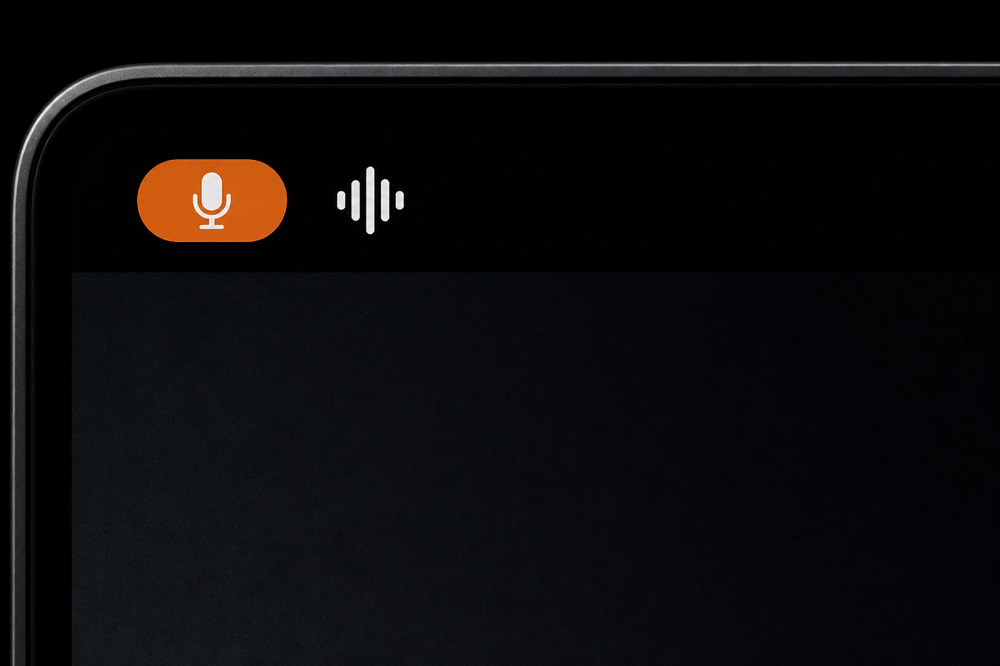

# VoiceToText

**Private local STT on your Mac.** Speech never leaves the machine. No cloud. No $20/month subscription.

<p align="center">
  
</p>



- **Option+Space** — speak, text pastes at the cursor
- **$0/month** — not SuperWhisper or cloud dictation
- **Native menu bar app** + one local model (Qwen 1.7B 8-bit by default; Whisper from the menu)
- **Same API for agents** — full transcript with timecodes, language per request, loopback only

```bash
curl -fsS http://127.0.0.1:8765/healthz
curl -fsS -F file=@sample.wav http://127.0.0.1:8765/v1/audio/transcriptions
curl -fsS -F file=@meeting.wav -F response_format=verbose_json -F language=auto \
  http://127.0.0.1:8765/v1/audio/transcriptions
```

Dictation stays Russian (`qwen3_asr.language: ru`). Agents override the language on a single request.

---

## Install in one command

Apple Silicon Mac (M1 or newer), macOS 13+. Paste into Terminal:

```bash
curl -fsSL https://raw.githubusercontent.com/FUYOH666/VoiceToText/main/scripts/install.sh | bash
```

The installer builds everything on your Mac from source, so no Developer ID or notarization is involved and Gatekeeper has nothing to block. It checks the Mac (asks for Xcode Command Line Tools if missing), installs [uv](https://docs.astral.sh/uv/) if needed, puts the source in `~/.voicetotext`, builds and signs `VoiceToText.app` with a local identity (macOS asks once to trust it, so permissions survive updates), downloads the speech model recommended for your Mac's memory, starts the services and adds the app to `~/Applications`. Run the same command again to update. Remove: `bash ~/.voicetotext/scripts/uninstall.sh` (add `--purge` to delete history and settings too).

Options go after `bash -s --`, e.g. `… | bash -s -- --model whisper-large-v3-turbo-8bit`. `--dry-run` prints the steps; `--no-model` skips the download. See the models: `cd ~/.voicetotext && uv run python scripts/prefetch_model.py --list`.

### From a clone (developers)

```bash
git clone https://github.com/FUYOH666/VoiceToText.git
cd VoiceToText
uv sync --extra qwen
macos/scripts/build.sh
uv run python src/vtt2/main.py --install
```

Either way you get two LaunchAgents: `ai.vtt2.stt` (model + HTTP on `127.0.0.1:8765`) and `ai.vtt2` (Swift `VoiceToText.app`).

Grant **Microphone** and **Accessibility** to **VoiceToText** — not Terminal, not python. Input Monitoring is not needed.

Hold Option+Space while you speak and let go to paste (push-to-talk), or tap it once to start and once more to stop; Esc cancels. Menu «Словарь терминов…» opens `~/Library/Application Support/VoiceToText/glossary.txt`: one name or term per line (Claude Code, Hugging Face, MLX…); they are sent with every dictation so the model spells them your way. Every recording is saved to `~/Library/Application Support/VoiceToText/recordings/` before it is sent (last 50, 7 days), so nothing is lost if the server fails: menu «Повторить последнюю запись» or «История». Your clipboard is restored after the paste, and nothing is pasted into password fields.

After an ad-hoc rebuild, macOS treats the binary as a new app: remove the old VoiceToText row in Privacy, add `macos/dist/VoiceToText.app` again, turn the toggles on.

```bash
uv run python src/vtt2/main.py --status
curl -fsS http://127.0.0.1:8765/healthz
```

---

## Deploy this for your business

Open source — run it yourself.

Or I can deploy, customize, and integrate it for your team in **2 weeks**.

**Free consultation:** [private@scanovich.ai](mailto:private@scanovich.ai) · Telegram [@ScanovichAI](https://t.me/ScanovichAI)

---

## How it works

1. Option+Space starts recording
2. Speak
3. Option+Space stops
4. The menu bar POSTs audio to local STT and pastes the text

The orange microphone pill is macOS (privacy). The waveform is VoiceToText.

Agents use the same `POST /v1/audio/transcriptions` — [docs/STT_API.md](docs/STT_API.md). `verbose_json` returns the full text plus segment start/end. `language=auto` or a code such as `language=en` applies to that file only.

Default profile loads Qwen3-ASR 8-bit on demand and unloads after 15 minutes idle. Always-on, same checkpoint: `config.resident.yaml`. Whisper is the menu item, not a second process.

---

## Configuration (short)

```yaml
stt_server:
  host: "127.0.0.1"
  port: 8765
  engine: qwen3_asr
  preload_on_start: false
  idle_unload_seconds: 900

transcription:
  engine: local_stt
  qwen3_asr:
    model_name: "moona3k/mlx-qwen3-asr-1.7b-8bit"
    quantization_bits: null
    language: "ru"
```

The checkpoint is pre-quantized 8-bit, group 64, about 2 GB. `quantization_bits: null` so it is not quantized again. Install it with the server: `uv sync --extra qwen`. A later plain `uv sync` removes that extra and the default server exits instead of falling back to Whisper.

```bash
uv sync --extra qwen
launchctl kickstart -k "gui/$(id -u)/ai.vtt2.stt"
```

On this Mac the first request downloaded 2.0 GB and answered a 3-second clip in 43 seconds. The same clip with the model already loaded took 0.22 seconds. After 15 minutes idle the weights unload; the next request loads that snapshot again and does not quantize it.

**Choosing a model.** Menu «Модель ▸» lists verified MLX checkpoints, quantized first: Qwen3-ASR 1.7B / 0.6B 8-bit, Whisper large-v3 and large-v3-turbo in 8-bit and 4-bit, fp16 for maximum quality, Whisper small as the minimum. Each item shows its download size or memory use; ★ marks the one recommended for your Mac's memory (16 GB and more: Qwen3-ASR 1.7B 8-bit; less: 0.6B 8-bit), and models that need more memory than you have are greyed out. Clicking a model that isn't downloaded yet downloads it in the background (dictation keeps working) and switches to it. «Своя модель с Hugging Face…» accepts any MLX Whisper or Qwen3-ASR repo. The choice is stored in `~/Library/Application Support/VoiceToText/config.yaml`, not in the repo. Remote GPU ASR stays under `transcription.engine: remote_asr` (host in gitignored `.env.vtt2`). `model=` on the POST does not switch checkpoints. Details: [docs/STT_API.md](docs/STT_API.md).

---

## Troubleshooting

**Paste does nothing:** Privacy → Accessibility → **VoiceToText**. Without that grant the text is left on the clipboard (Cmd+V) and the status line says so. Menu: «Разрешения…».

Daily builds sign with the login-keychain identity `vtt-local-codesign`, so those two grants survive the next rebuild. Create it once: `macos/scripts/setup-local-signing.sh`. The first rebuild after an ad-hoc signature still needs one grant. Without that identity, `build.sh` signs ad-hoc and macOS drops the grants every time.

**STT slow / `readyz` 503:** idle-unload. `healthz` is enough; the next POST loads the model. Always-on: `cp config.resident.yaml config.yaml && uv run python src/vtt2/main.py --install`.

**After a git pull of STT:** restart the model process so agents see the new contract — `launchctl kickstart -k gui/$(id -u)/ai.vtt2.stt`. Menubar can stay running.

**Two menu bar icons:** `uv run python src/vtt2/main.py --install` kills leftover UI (not `--serve-stt`).

Logs: `~/Library/Logs/vtt2/` (`voicetotext.log`, `stt.stdout.log`).

---

## Development

```bash
uv run pytest
macos/scripts/test.sh
```

Notarized `.app` needs Apple Developer + `macos/Signing.xcconfig` (not in git) and `macos/scripts/release.sh`. No signed public zip is attached until a Developer ID exists.

MIT. Built with [MLX](https://github.com/ml-explore/mlx).
