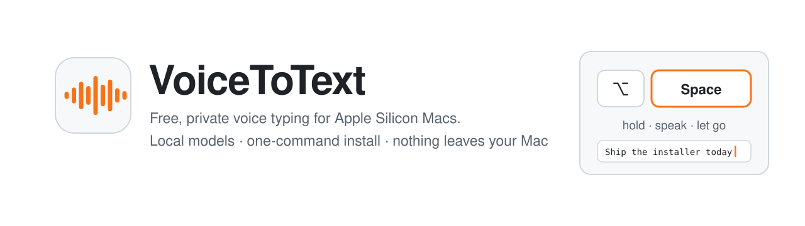
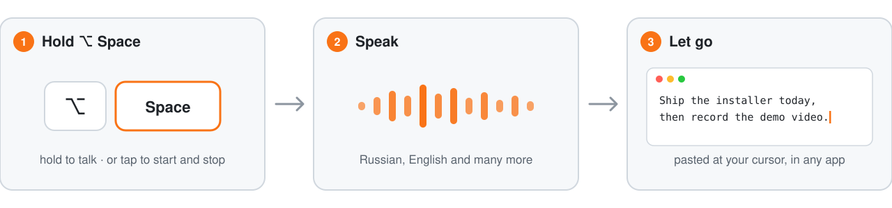

<p align="center">
  <picture>
    <source media="(prefers-color-scheme: dark)" srcset="docs/assets/banner-dark.svg">
    
  </picture>
</p>

<p align="center"><a href="README.md">English</a> · <b>Русский</b></p>

**Зажмите <kbd>⌥ Option</kbd> + <kbd>Space</kbd>, говорите, отпустите — текст появится там, где стоит курсор.** VoiceToText живёт в строке меню Mac на Apple Silicon и превращает голос в текст моделями, которые работают на вашем же компьютере. Без регистрации, подписки и облака.

<p align="center">
  <picture>
    <source media="(prefers-color-scheme: dark)" srcset="docs/assets/how-it-works-dark.svg">
    
  </picture>
</p>

## Зачем

Говорим мы примерно 150 слов в минуту, а печатаем на клавиатуре около 52 ([исследование Aalto University, 168 тысяч человек](https://aalto.fi/en/news/the-traits-of-fast-typists-discovered-by-analysing-136-million-keystrokes)) — почти втрое медленнее. Когда руки не успевают за головой, мысль теряется: переключаешься, сокращаешь идею, забываешь вторую половину. Голос держит поток. Вы можете сказать больше, чем нужно, но точно не меньше, а лишнее легко вычеркнуть.

Инструмент для тех, кто весь день думает вслух: предпринимателей, руководителей, инженеров — всех, кто много пишет сообщений, заметок и промптов.

## Установка

Mac на Apple Silicon (M1 и новее), macOS 13 Ventura или новее. Вставьте в Терминал:

```bash
curl -fsSL https://raw.githubusercontent.com/FUYOH666/VoiceToText/main/scripts/install.sh | bash
```

Установщик собирает приложение прямо на вашем Mac, поэтому macOS не ругается на неподписанную программу. Он проверит компьютер, поставит [uv](https://docs.astral.sh/uv/), положит всё в `~/.voicetotext`, скачает модель под объём вашей памяти и запустит приложение. macOS один раз спросит доступ к **микрофону** и **Универсальному доступу** (для вставки текста). Повторный запуск той же команды обновляет программу. Удаление: `bash ~/.voicetotext/scripts/uninstall.sh`.

## Возможности

- **Удержание или нажатие.** Держите <kbd>⌥ Space</kbd>, пока говорите, или нажмите один раз для начала и ещё раз для конца. <kbd>Esc</kbd> отменяет.
- **Выбор модели.** Сначала квантованные MLX-модели, звёздочкой ★ отмечена подходящая под память вашего Mac. Скачивание идёт в фоне; можно добавить любую MLX-модель Whisper или Qwen3-ASR с Hugging Face.
- **Говорите на любом языке — получайте английский.** «Перевод на английский» использует встроенный перевод Whisper.
- **Ваши термины пишутся правильно.** Словарь имён и терминов (Claude Code, Hugging Face, MLX…) отправляется с каждой диктовкой.
- **Ничего не теряется.** Запись сохраняется до отправки. При ошибке «Повторить последнюю запись» отправит её снова, «История» хранит последние диктовки.
- **Бережно к Mac.** Буфер обмена восстанавливается, в поля паролей текст не вставляется, модель выгружается после 15 минут простоя.
- **Whisper без зацикливаний.** Тишина обрезается, повторы схлопываются, длинные записи не заканчиваются «Продолжение следует…».
- **API для агентов.** Тот же локальный сервер говорит на OpenAI audio API, так что скрипты и ИИ-агенты тоже могут расшифровывать файлы.

## Модели

| Модель | Скачать | Память | Для чего |
|---|---|---|---|
| Qwen3-ASR 1.7B · 8-bit ★ | 2,2 ГБ | ~2,7 ГБ | По умолчанию на 16 ГБ+. Русский с английскими терминами, пунктуация |
| Qwen3-ASR 0.6B · 8-bit ★ | 0,84 ГБ | ~1,2 ГБ | По умолчанию на Mac с 8 ГБ |
| Whisper large-v3 | 3,1 ГБ | ~3,6 ГБ | Максимальная точность Whisper, 99 языков, перевод на английский |
| Whisper large-v3 · 8-bit | 1,7 ГБ | ~2,3 ГБ | Почти та же точность, вдвое легче, перевод |
| Whisper large-v3 turbo · 8-bit / 4-bit | 0,86 / 0,46 ГБ | ~1,3 / 0,9 ГБ | Быстро и легко |
| Whisper small | 0,48 ГБ | ~0,7 ГБ | Минимальные требования |

## Для ИИ-агентов

Локальный сервер `http://127.0.0.1:8765` реализует OpenAI audio API и слушает только этот Mac. Подойдёт и официальный OpenAI SDK с `base_url="http://127.0.0.1:8765/v1"`. Примеры и полный контракт: [README на английском](README.md#for-ai-agents), [docs/STT_API.md](docs/STT_API.md).

## Вопросы

- **Уходит ли звук с моего Mac?** Нет. Сеть нужна только чтобы скачать зависимости и модели (с Hugging Face). Скачанная модель грузится с диска без интернета. Телеметрии нет.
- **Почему в строке меню оранжевый микрофон?** Это индикатор приватности macOS, его показывает сама система, когда любое приложение слушает микрофон. VoiceToText использует только микрофон, камеру — никогда.
- **Работает ли на Intel, Windows, Linux?** Пока нет: модели работают на MLX, а он требует Apple Silicon.

## Для команд

VoiceToText бесплатный и открытый. Если нужно внедрить его в компании — свой словарь, свои модели, связка с вашими инструментами и ИИ-агентами — пишите на [private@scanovich.ai](mailto:private@scanovich.ai) или в Telegram [@ScanovichAI](https://t.me/ScanovichAI).

Лицензия MIT.
